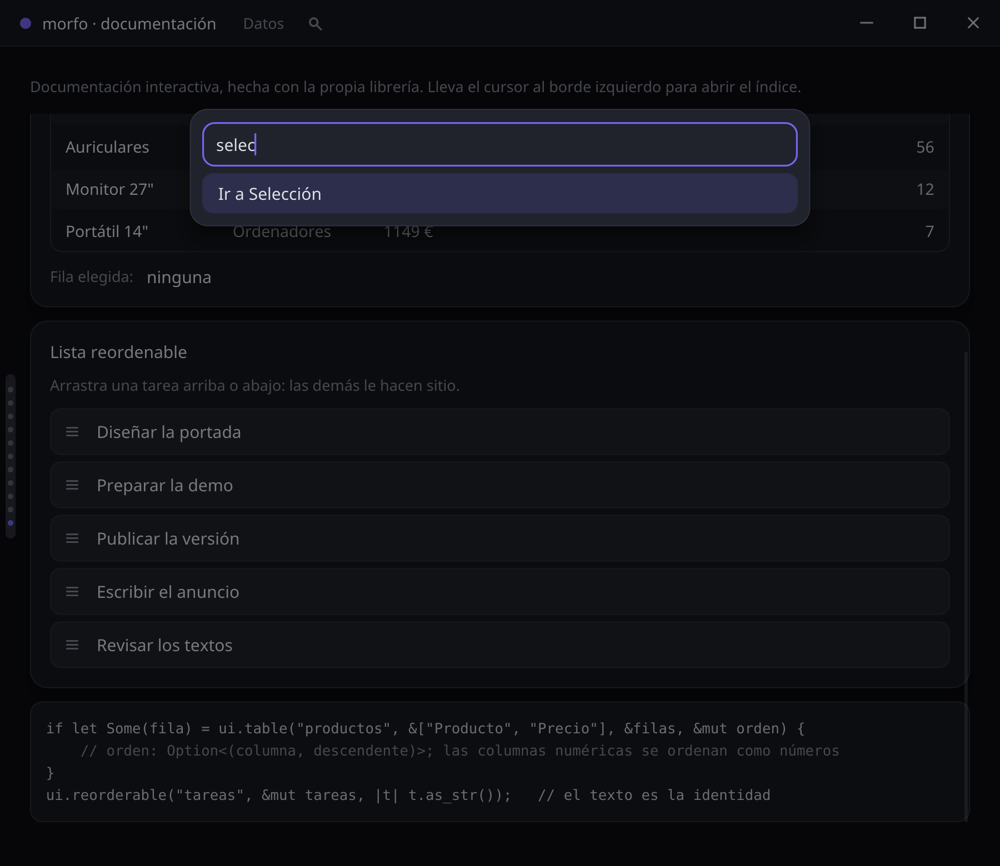
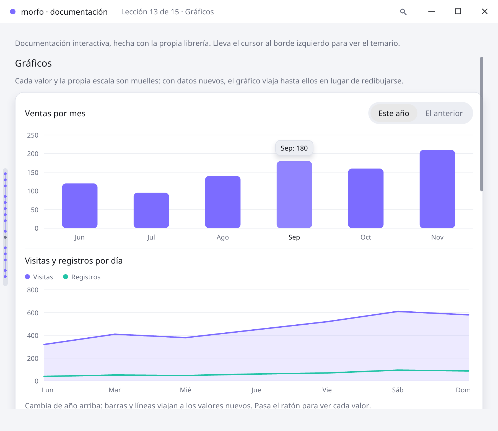
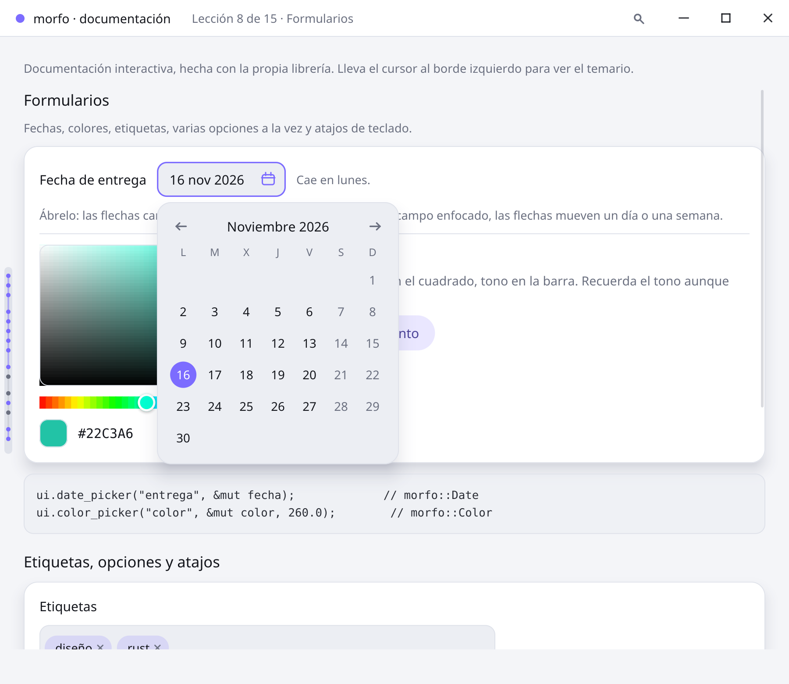
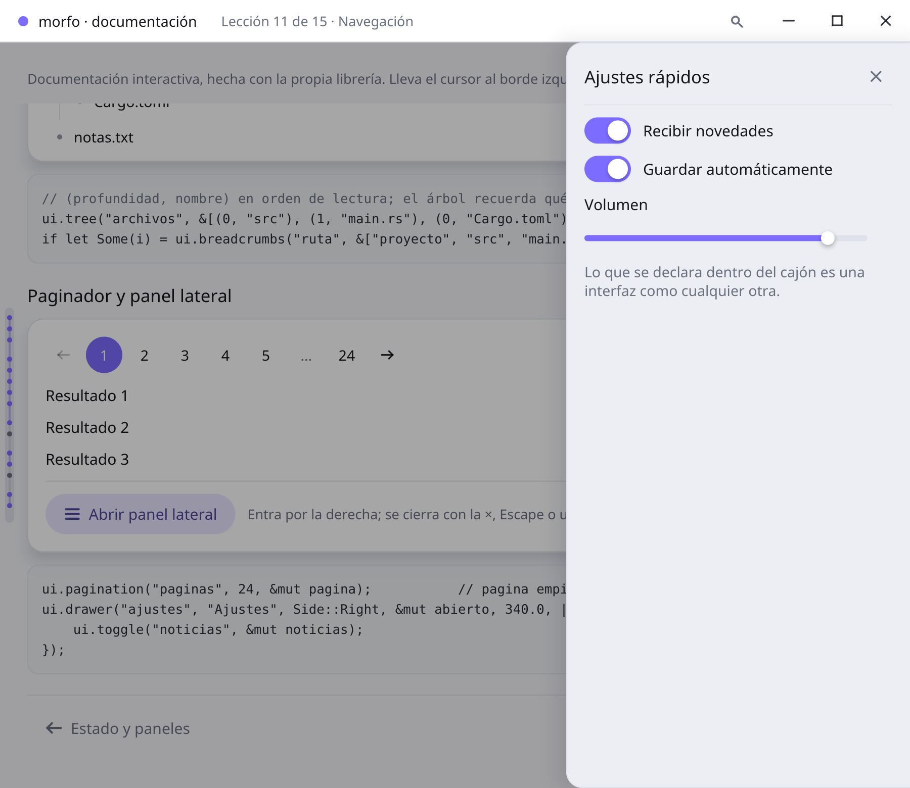
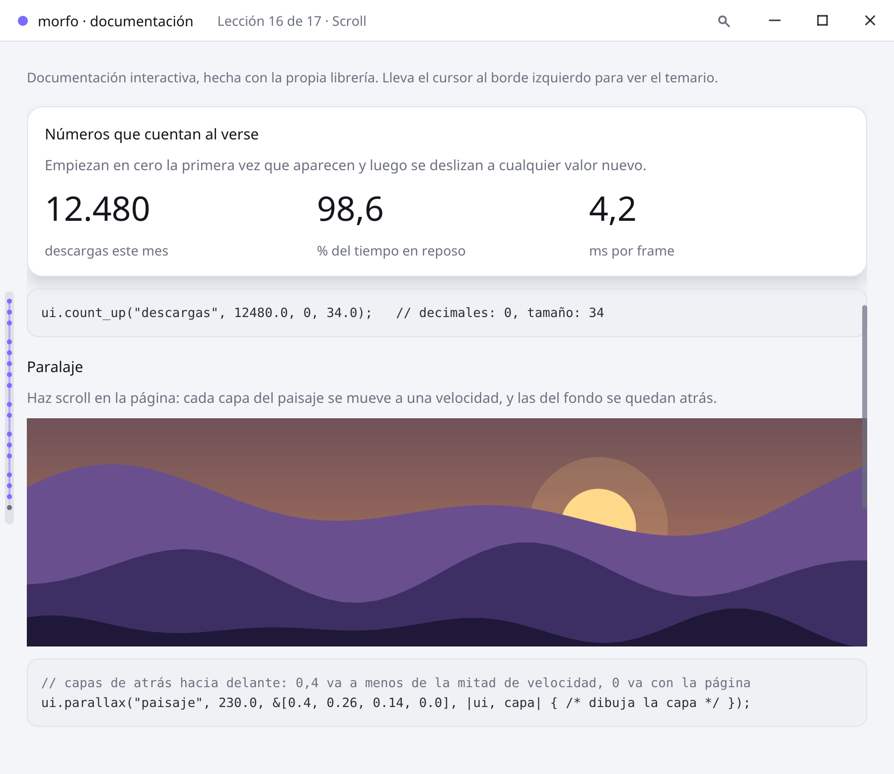
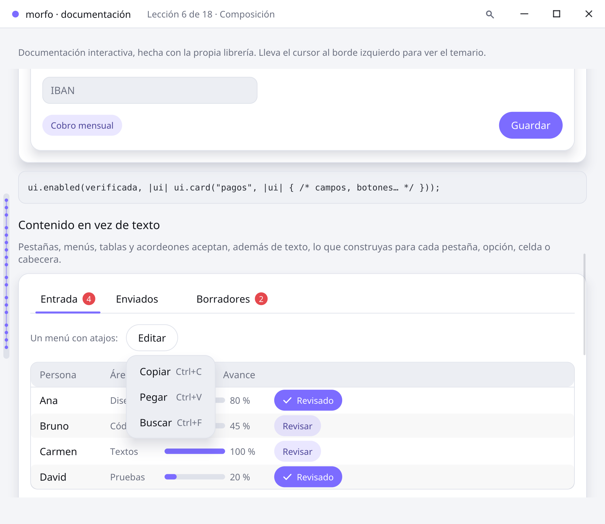

# morfo

**English** · [Español](README.es.md)

Interface components in Rust where **everything changes fluidly** and the
interface **adapts to each person by how they use it**. Two people using the
same program can end up with different interfaces.

| Interactive documentation | Course index, unfolded |
| --- | --- |
|  |  |
| **An interface already adapted to its use** | **Kinds of button and their variants** |
|  |  |
| **Controls, with another accent color** | **Command palette (Ctrl+K)** |
|  |  |
| **Search unfolded from the magnifier** | |
|  | |
| **A table sorted by price** | **Grid, columns and alignment** |
|  |  |
| **What you usually do next** | **Your habits, with their reasons** |
|  |  |
| **Free drawing: arcs and polygons** | **The same interface painted by the GPU** |
|  |  |
| **A dialog growing out of its button** | **Selection controls** |
|  |  |
| **A button morphing into a card** | **Morphed by use** |
|  |  |
| **Charts travelling to their data** | **The calendar of a date picker** |
|  |  |
| **A side panel over the content** | **Board: a card in hand** |
|  |  |
| **Parallax: each layer at its speed** | **A photo flying to its detail** |
|  |  |
| **Your own content in tabs, menus and tables** | |
|  | |

(The documentation app is in Spanish; the components speak English by
default and any other language through a `Locale`.)

## Key ideas

- **Identity = morph.** Every element has a stable `Id`. The layout only
  computes *targets*; springs carry position, size, radius, colors and type
  there. Reordering, resizing, switching variant or theme is always a
  continuous transition, with no animation code to write.
- **Morphing.** One component can become a different one (a button a text
  field, a checkbox a card): `ui.morph(key, form, …)` moves the background
  shape from one to the other (position, size, radius and color) while the
  content cross-fades and the neighbours make room at the same pace. The
  "form" can be any `Hash` value, including the weight use has given an
  element.
- **Components inside components.** A keyed container (`card`, `dialog`,
  `scroll`, `accordion`, `transition`…) owns what it holds: their keys live
  under its own, so a component made of others can be repeated without its
  parts colliding, and `ui.find(key)` finds something nested without writing
  its path. Any content can be a button (`pressable`), be switched off as a
  whole (`enabled`) or inherit size, accent and variant (`with_size`,
  `with_accent`, `with_variant`).
- **Scrolling and transitions.** What is inside a scroll area moves with it
  as one piece, and can react to it: come in when seen (`scroll_reveal`,
  staggered when several arrive), count up (`count_up`), move at another
  speed (`parallax`) or stick to the top (`sticky_section`).
  `ui.transition(key, view, style, …)` changes view with one of seven
  choreographies, in the direction of travel, and what two views share
  (`hero`) flies from one place to the other.
- **Analytic springs.** The closed-form solution of the damped spring is
  linear in position and velocity, so its 4 coefficients are computed once a
  frame and each animated value advances with 4 multiplications. Exact at any
  refresh rate, interruptible at any moment keeping its velocity.
- **Adaptive engine.** `Profile` keeps, per element, a usage score that
  decays over time. From it come order (`arrange`) and visual weight
  (`prominence`), both with hysteresis so nothing jitters. Nothing moves
  while the pointer is over it. It also learns *when* each thing is used
  (time of day) and *what comes after what* (`predict`), and can explain why
  it put something where it is (`explain`). The profile serializes to text,
  to keep one per user.
- **The person is in charge.** They can see what the interface has learned
  (`ui.habits()`, with names and reasons), forget a habit (`forget`), pause
  learning (`frozen`), copy their profile or erase it. And how much it adapts
  is a choice (`set_adaptation`: off, suggestions only, on request, or
  continuous), because an interface that rearranges itself does not suit
  everyone.
- **Zero cost at rest.** `ui.end()` says whether anything is still moving;
  if not, the program draws and computes nothing until the next event.
- **Only the work that shows.** A steady frame of the core allocates no
  memory (checked in CI). Text measurements and the line breaking of each
  paragraph are remembered while they do not change; cards far from the view
  of their scroll area are not built; the CPU renderer repaints only the
  rectangle that changed; and on battery, animations run at 30 frames per
  second.
- **Renderer independent.** The core has no dependencies and produces a flat
  list of primitives. There are three backends: CPU (`morfo-skia`), GPU
  (`morfo-wgpu`) and web (`morfo-web`, WebAssembly on a canvas). A test
  checks that CPU and GPU paint the same picture.
- **Accessible.** Everything works with the keyboard (Tab, Enter, Space,
  arrows) with a focus ring that springs from element to element, and with a
  gamepad or a remote (`move_focus`). The interface describes itself to
  screen readers as a tree (groups, dialogs, lists): AccessKit on the
  desktop, an ARIA mirror on the web. It follows the system's "reduce
  motion" (`set_motion`), checks the theme's contrast (`contrast_issues`),
  ships high-contrast themes, enlarges text (`set_text_scale`) and announces
  form errors.
- **Any language.** The words and formats the components show by
  themselves (months, "More…", numbers, dates, key names) come from a
  `Locale` (English and Spanish included). With `rtl` the whole interface is
  drawn as in a mirror and Hebrew or Arabic lines read from the right.

## Use

The shortest way to a window is `morfo-winit`: it opens the window, paints
with the GPU (or the CPU when there is none), passes on keyboard, mouse,
touch, input methods and clipboard, publishes accessibility and follows the
system's settings (reduced motion, battery):

```rust,no_run
use morfo_winit::{run, Options};

run(Options::new("Hello"), |ui, _cx| {
    ui.heading("Hello");
    if ui.button("greet", "Greet").clicked {
        println!("Hello!");
    }
})
.unwrap();
```

With an event loop of your own, use the core directly:

```rust
use morfo::{Theme, Ui, Vec2};

let mut ui = Ui::new(Theme::dark());
let mut dark = true;

// every frame:
ui.begin(time_in_seconds, Vec2::new(width, height));
ui.heading("Hello");
if ui.button("save", "Save").clicked { /* ... */ }
ui.toggle("dark", &mut dark);
// A bar that reorders and resizes itself by how this person uses it:
if let Some(i) = ui.adaptive_actions("actions", &[("new", "New"), ("open", "Open")]) { /* ... */ }
let frame = ui.end();

renderer.render(ui.draw_list(), &mut pixmap, scale, ui.background());
if frame.animating { /* ask for another frame */ }
```

Input goes in with `pointer_moved`, `pointer_pressed`, `pointer_released`,
`pointer_left`, `scroll_wheel`, `key_pressed`, `text_input`, `paste`,
`ime_preedit`, `set_modifiers`, `touch_started`, `touch_moved`,
`touch_ended`, `pinch_moved` and `move_focus`; copied text comes out of
`take_clipboard`. When `frame.animating` is false, `frame.wake_in` says in
how many seconds a frame will be needed without any input (a notice that
expires, the text caret). To keep and restore each user's shape:
`ui.profile().encode()` and `ui.set_profile(Profile::decode(text)?)`. To
pick the interface up where it was after relaunching the program:
`ui.save_state()` and `ui.restore_state(text)` (each scroll position), and
`ui.set_instant(true)` for a few frames without painting so the first one
seen is already still and in place.

### Components

| Group | Components |
| --- | --- |
| Text | `label`, `muted`, `title`, `heading`, `text` (any size), `code`, `paragraph` and `paragraph_muted` (wrap to the width), `rich` (a paragraph of runs in bold, italic, monospace, accent or muted) |
| Buttons | `button`, `button_with`, `icon_button` (icon only), `button_icon` (icon and text), `toggle_button` (stays pressed), `loading_button` (shrinks into a spinner while busy), `hold_button` (hold to confirm). All in the variants `Solid`, `Soft`, `Outline`, `Ghost` and the sizes `Sm`, `Md`, `Lg` |
| Icons | `Icon`: 18 vector icons (arrows, close, search, home, download, play, maximize…) and your own from 24×24 SVG path data (`Icon::Stroke`, `Icon::Fill`), as Lucide, Material or Tabler publish them |
| Controls | `toggle`, `slider`, `progress`, `segmented`, `range_slider` (two handles), `knob`, `xy_pad` (two axes), `rating` (stars), `swatches` (color samples) |
| Selection | `checkbox`, `radio`, `chip`, `stepper`, `accordion` |
| Boxes | `row`, `row_top`, `fill` (pushes the rest of the row to its end), `column`, `grid`, `columns` (weighted widths), `align`, `card`, `separator`, `reveal`, `scroll` (bounces past its ends), `scope`, `surface`, `canvas` (free drawing), `presence`, `transient` (any content animates its exit), `splitter` (two panes and a draggable divider), `virtual_list` (rows of one height, only the visible ones built: a hundred rows cost the same as a hundred thousand) |
| Floating | `dialog`, `menu`, `tooltip`, `toast`, `notice` (a corner notice while declared: work in progress, offline, an error), `close` |
| Navigation | `course_nav` (a course index on the left edge: modules, numbered lessons on a timeline, remembered progress), `side_nav` (a simple index), `search` (a magnifier that unfolds into a search box with results), `tabs` (an underline that jumps between tabs), `breadcrumbs` (the middle folds into "…" when short of room), `tree` (branches that unfold; it remembers which), `pagination`, `drawer` (a panel from one side of the window) |
| Window | `title_bar` (the application's own title bar instead of the window manager's: title, your content, minimize, maximize/restore, close, dragging, double click and edges to resize) |
| Input | `text_field` and `text_area` (selection with mouse and Shift, double click for a word, Ctrl+A/C/X/V, undo and redo, Ctrl+arrows and Ctrl+Backspace by words, input methods; the area wraps and scrolls), `password_field` (dots for letters; never copied), `number_field` (a number with the locale's decimals and separators, within a range), `field` (label, content and an error announced to screen readers), `select`, `combobox` (suggestions that ignore accents), `date_picker` (a month calendar, with the `Date` type), `color_picker` (saturation/value square, hue bar), `tag_input` (what is typed becomes tags), `multi_select` (several options with a search), `shortcut_input` (records a key combination as a `Shortcut`; the program passes Ctrl+key with `chord` while `wants_keys`) |
| Data | `table` (sortable by column; rows travel when sorted), `reorderable` (a list reordered by dragging), `kanban` (a board of columns; cards are dragged between them), `draggable` and `drop_target` (any content dragged onto any target, carrying a payload of yours) |
| Images | `add_image` (RGBA pixels), `image` (with `Fit::Cover`, `Contain` or `Fill`, rounded corners and alternative text), `replace_image`, `remove_image` |
| Charts | `bar_chart`, `line_chart` (several series), `sparkline` (a trend in one line), `heatmap`, `gauge`: values and scales are springs, and hovering shows each value |
| Status | `skeleton` (grey shimmering lines that turn into the content once loaded), `badge` and `badge_on` (a count that jumps when it changes and leaves at zero), `steps` (multi-step processes) |
| Adaptive | `adaptive_actions`, `adaptive_menu`, `suggestions`, `predicted_action` (offers the usual next step), `adaptive_dashboard` (a home that reorders and enlarges what is used most), `command_palette`, `set_adaptive_density` (more compact the more it is used), `set_adaptation`, `habits`, `why` |
| Accessibility | `set_accessibility`, `access_nodes`, `access_click`, `access_focus`, `move_focus`, `set_motion`, `set_text_scale`, `Theme::contrast_issues`, `Theme::high_contrast` |
| Language | `set_locale` with `Locale::ENGLISH`, `Locale::SPANISH` or one of your own; `with_rtl(true)` for right-to-left scripts; `bidi::visual` |
| Drawing | `DrawList::polygon`, `arc`, `gradient` (linear), `dashed_line`, rectangles, lines and text (inside `canvas`); `Path` (lines, Bézier curves and arcs, in code or from SVG data, filled or stroked at any size) |
| Morphing | `morph` (any component or group turns into another), `request_focus` |
| Scrolling | `scroll_reveal` (comes in when seen with `Reveal::Fade`, `Rise`, `Left`, `Right`, `Grow` or `Wipe`; those arriving together, one after another), `count_up` (a number counting from zero when seen), `parallax` (layers at different speeds), `sticky_section` (a header that stays until the next one pushes it; they nest), `anchor` and `scroll_to` (a spring ride to a section), `scroll_progress` and `scroll_linked` (values tied to the position) |
| Composition | `pressable` (any content as a button; the controls inside stay theirs), `enabled` (switches off everything inside: dimmed, no pointer or keyboard, announced as disabled), `tabs_with`, `menu_with`, `table_with` and `accordion_with` (each tab, option, cell or header shows what you build), `with_size`, `with_accent` and `with_variant` (a style what is inside inherits), `find` and `find_all` (the element declared with a key, wherever it is) |
| Transitions | `transition` (a change of view with `Transition::Fade`, `Slide`, `Shift`, `Push`, `Zoom`, `Flip` or `Rise`, in the direction of travel), `hero` (a shared element flying from one view to the other) |
| Tools | `testing::Harness` (tests an interface without a window: clicks and types by key, reads back what is drawn and announced), `set_inspector` (outlines the element under the pointer with its key and size), `Theme::to_tokens` and `from_tokens` (the theme as CSS custom properties for design tools) |

Floating elements are drawn on upper layers, block what they cover and also
animate their exit. To adapt components of your own: `ui.affinity(key)`,
`ui.prominence(key)`, `ui.record(key)` and `Profile::arrange`.

### Testing

```rust
use morfo::testing::Harness;

let mut count = 0;
let mut h = Harness::new();
let mut app = |ui: &mut morfo::Ui| {
    ui.label(&format!("Clicked {count} times"));
    if ui.button("more", "More").clicked {
        count += 1;
    }
};
h.settle(&mut app);
h.click("more", &mut app);
assert!(h.shows("Clicked 1 times"));
```

## Documentation with examples

```bash
cargo run --release -p morfo-demo --bin docs
```

It paints with the GPU if there is one (otherwise with the CPU; `-- --cpu`
forces it).

### Live changes while you develop

Started with `cargo run` (the command above), the documentation reloads by
itself. Saving a source file (of the demo, the core or a renderer)
recompiles in the background and relaunches it in place: the same page, the
same scroll and theme, what was typed in fields, and the window where it
was, without taking the keyboard from the editor. While it compiles it says
so in a corner; if it does not compile, the previous version keeps running
and the notice shows the first error.

A reload takes as long as the incremental build, and in release (because of
LTO) that is over a minute. So the documentation always reloads with the
`dev` profile, even when started with `--release`: 1 to 5 s per change. The
first reload builds that profile in full if it does not exist yet (a few
minutes, once). `MORFO_LIVE_PROFILE=release` keeps reloads optimized and
`MORFO_LIVE=0` turns them off. A binary started without `cargo run` watches
nothing.

For an application of your own it is the `morfo-live` crate (no
dependencies, Unix):

```rust
use morfo_live::{Live, Snapshot, Status};

struct State { page: usize, name: String }
morfo_live::persist!(State { page, name });   // generates save() and restore()

// At start-up: what the previous build left, if this is a reload.
if let Some(snap) = morfo_live::restored() {
    state.restore(&snap);
    ui.restore_state(&snap.get::<String>("ui").unwrap_or_default());
}
// `wake` is called from another thread when the reload's status changes.
// It rebuilds with the profile it was started with; `start_with_profile("dev", …)`
// keeps reloads fast even when started with `--release`.
let live = Live::start(wake);

// In the event loop:
match live.status() {
    Status::Building => ui.notice("live", "Rebuilding…"),
    Status::Failed(error) => ui.notice("live", &error),
    Status::Ready => {
        let mut snap = Snapshot::new();
        state.save(&mut snap);
        snap.set("ui", &ui.save_state());
        live.restart(&snap);   // the process becomes the new build
    }
    Status::Watching => {}
}
```

Values are kept by name: a field the new build no longer has is ignored and
a new one keeps its default, so the state survives the same code changes
that trigger the reload. The complete example, with the window's position,
is in `demo/src/bin/docs.rs`.

The same documentation runs in the browser:

```bash
./web/build.sh && python3 -m http.server -d web 8000
```

It needs `rustup target add wasm32-unknown-unknown` and `wasm-bindgen-cli`
at the version in `Cargo.lock`.

The documentation is an application made with morfo. It has eighteen pages
(Home, Buttons, Controls, Selection, Boxes, Composition, Shapes, Input,
Forms, Floating, Status and panels, Navigation, Data, Charts, Adaptive,
Morphing, Scrolling and Transitions), ordered as a course of five modules;
changing lesson, the new one arrives from the side being moved towards. The
course index lives on the left edge: it unfolds when the pointer comes
near, marks the lessons seen and remembers the progress. Top right, a
magnifier unfolds into a search of lessons and actions (Ctrl+K on the
desktop), and each lesson ends with buttons to the previous and the next
one. Each page explains a group of components, shows them working and the
code that produces them. Its source, `demo/src/lib.rs`, is also a complete
example. The usage profile is saved on exit to
`~/.config/morfo-demo/profile.txt`.

```bash
cargo run --release -p morfo-demo --bin bench
```

Measures what building a frame costs (time, memory allocations and
primitives) on each page and in scenes of the library alone; with
`-- --check` it fails if a steady frame allocates memory (CI runs it).

```bash
cargo run --release -p morfo-demo --bin snapshot
```

Walks through the documentation as a user would, without a window; saves PNG
frames to `out/` and measures the actual work.

```bash
cargo test --workspace
```

Includes the pixel-by-pixel comparison of GPU and CPU (skipped without a
GPU).

## Measurements

With the documentation (`--release`, a 900×780 window at 2× = 1800×1560 px,
a 4-core laptop with other programs open). They come from
`cargo run --release -p morfo-demo --bin snapshot`:

| Situation | Painting per frame | Rows covered |
| --- | --- | --- |
| At rest | nothing | 0 % |
| Moving the mouse over buttons | 0.3–0.6 ms | 6 % |
| Typing in a text field | 0.2–0.4 ms | 4–7 % |
| Changing page (everything moves) | ~9 ms | 86 % |
| Opening a dialog (dims the screen) | ~11 ms | 72 % |

Building the interface and advancing every animation costs about 50 µs per
frame on average in the documentation (30 to 100 µs depending on the page),
and a steady frame of the core allocates no memory. What is far from view
does not count: a scroll page of 2000 cards of ten buttons is built in
0.17 ms, and a virtual list costs the same with a hundred rows as with
twenty thousand.

The CPU renderer repaints only the rectangle that changed since the previous
frame, splits it into bands across threads and draws rectangles and shadows
with a rasterizer of its own that only works on the outline. The simulator
checks that the incremental result is identical, pixel for pixel, to a full
repaint.

## Layout

| Path | What it is |
| --- | --- |
| `crates/morfo` | The dependency-free core (`morfo-ui` on crates.io, imported as `morfo`): springs, adaptive profile, layout, components, accessibility, draw list |
| `crates/morfo-winit` | A ready window: event loop, GPU or CPU, input, clipboard, AccessKit, system settings and system fonts |
| `crates/morfo-fonts` | The renderers' fonts: regular, bold, italic, monospaced, and fallbacks for other scripts and symbols |
| `crates/morfo-skia` | CPU renderer with partial, parallel repaints |
| `crates/morfo-wgpu` | GPU renderer (wgpu): one shader, one draw call per clip region |
| `crates/morfo-web` | Web backend: canvas, browser events, clipboard, input methods, ARIA |
| `crates/morfo-live` | Live reload while developing: watches the sources, rebuilds and relaunches the program keeping its state |
| `demo` | Windowed documentation (GPU or CPU, AccessKit, clipboard), benchmark and windowless simulator |
| `web` | The documentation compiled to WebAssembly |

## Current limitations

- Live reload relaunches the whole program (Unix only): whatever is not kept
  in the `Snapshot` starts over, the window flickers for an instant and on
  Wayland it comes back where the compositor decides.
- Right-to-left text is a simplified bidirectional algorithm (no explicit
  embedding marks), and Arabic is drawn with its letters unjoined: there is
  no text shaping, so Indic scripts are not drawn right either. Inside a
  text field, text is shown in the order it is stored. Arrow keys are not
  swapped in a mirrored interface.
- Without an italic font, italic is drawn upright; without a bold one, bold
  is imitated by drawing twice.
- No background blur (frosted glass): too costly for a CPU renderer that
  repaints only what changes.
- One window: menus, dialogs and notices are drawn inside it.
- The core needs `std` (there is no `no_std` build for microcontrollers).
- The table draws all its rows; for thousands of rows, use `virtual_list` or
  paginate.
- Scrolling is vertical (wheel, scroll bar, touch drag with momentum,
  PageUp/PageDown). Inside a scroll area, cards far from view are not built:
  they keep the size they had when last seen, so if their content changes
  size meanwhile, the new size only shows as they come near, and `find` does
  not find what they hold. The rest of the content out of view is not drawn
  but is laid out. `set_lazy(false)` turns it off.
- `virtual_list` places rows exactly up to some tens of thousands; far
  beyond that they may be a fraction of a pixel off.
- During a morph, a transition or a `scroll_reveal` entrance, new controls
  already respond at their final position, even while still drawn halfway.
  The view leaving in a transition is just a picture: it does not respond,
  and what it had on floating layers disappears at once.
- `title_bar` does not move or close the window itself: it returns what the
  user asked for and the program does it. Dragging and resizing depend on
  the window manager.
- On the web, text is drawn by the browser with system fonts, so a pixel may
  differ from the desktop; clipping is rectangular, and images are not
  tinted in color (only in opacity).
- The CPU backend clips by rectangles: it ignores the corner radius of a
  clip.
- Time-of-day habits need the program to give the time zone
  (`Profile::time_of_day`); `morfo-winit`, the demo and the web do.

## Contributing

Contributions are welcome. Read [CONTRIBUTING.md](CONTRIBUTING.md) before
opening a PR and follow the [code of conduct](CODE_OF_CONDUCT.md). Security
issues are reported privately: [SECURITY.md](SECURITY.md).

## License

MIT or Apache-2.0, at your option.
