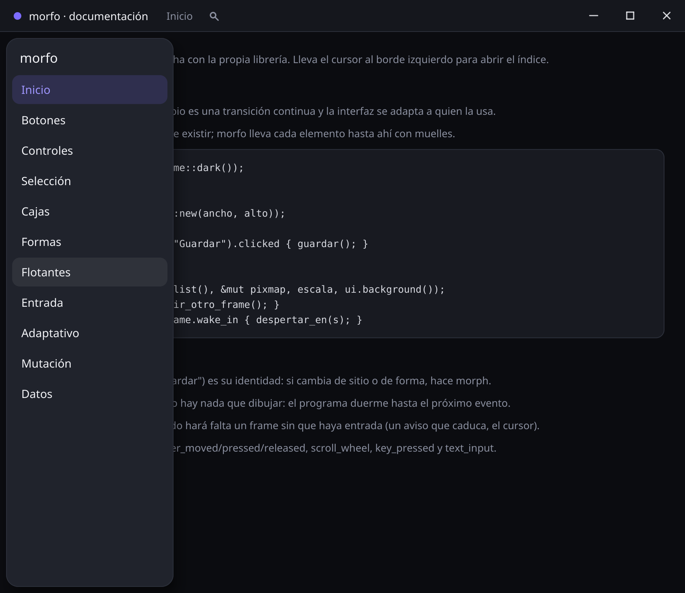
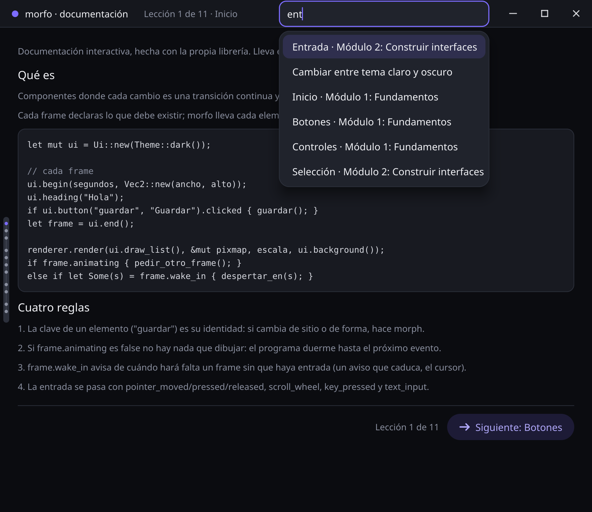
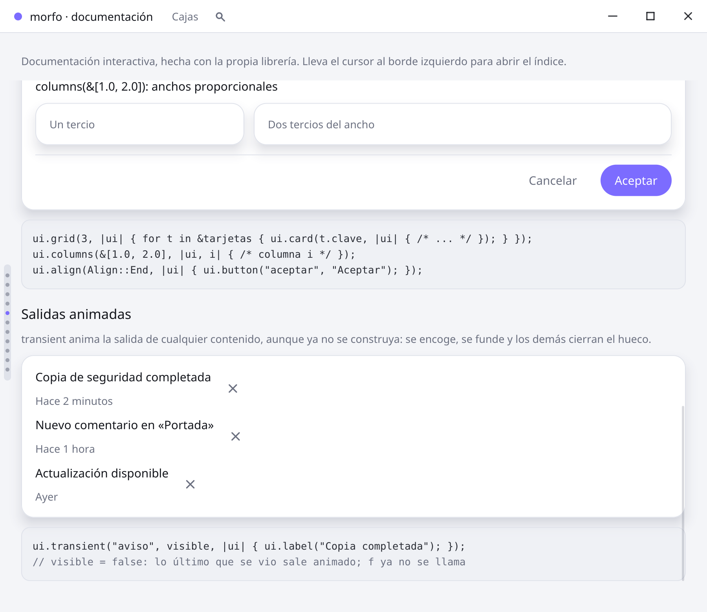
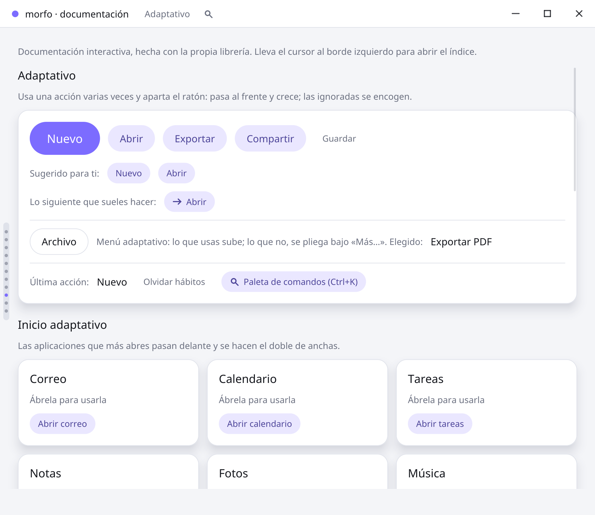
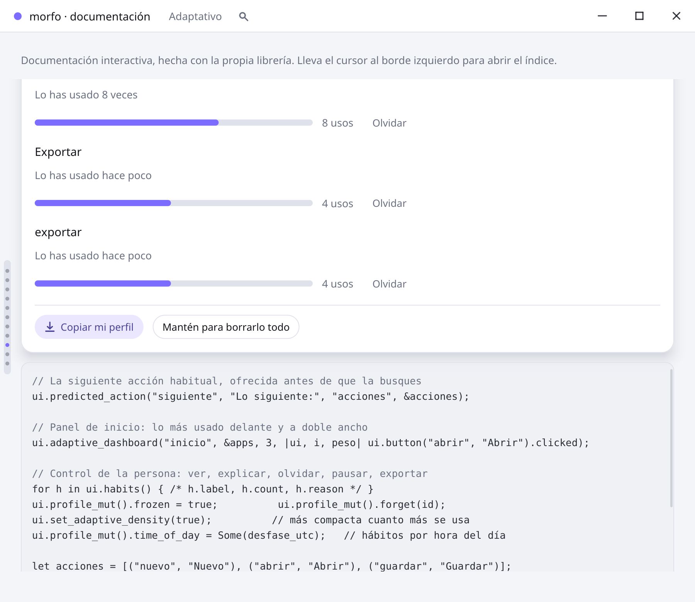
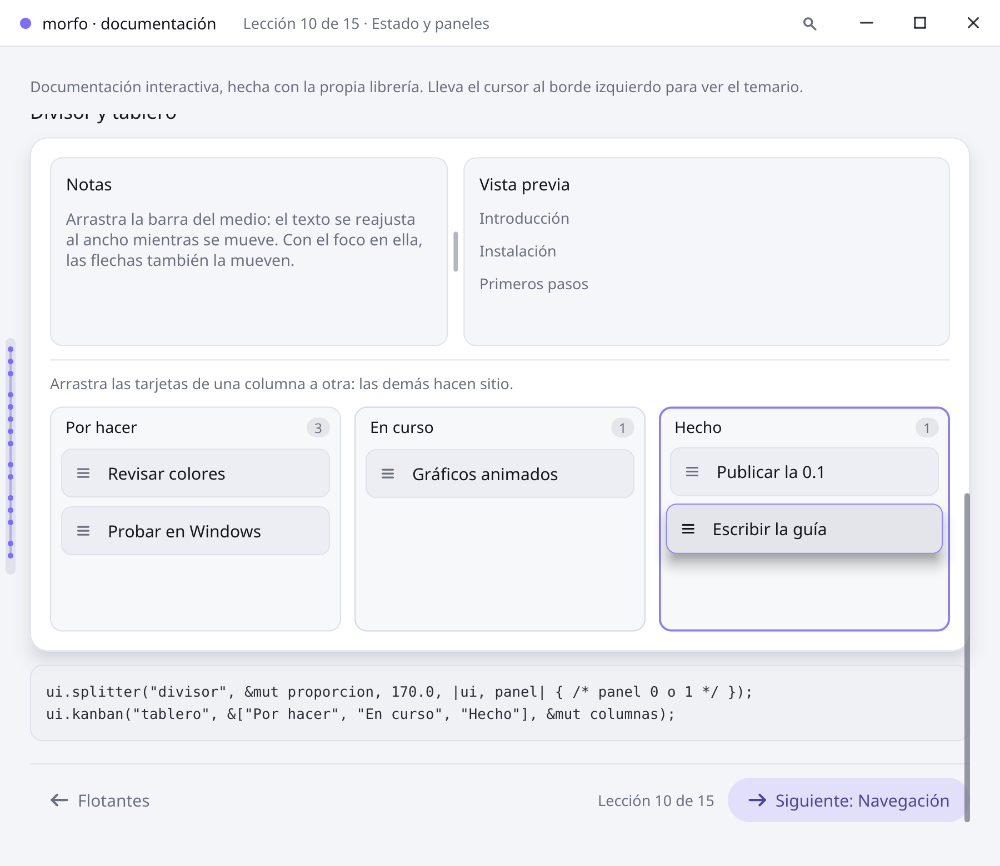
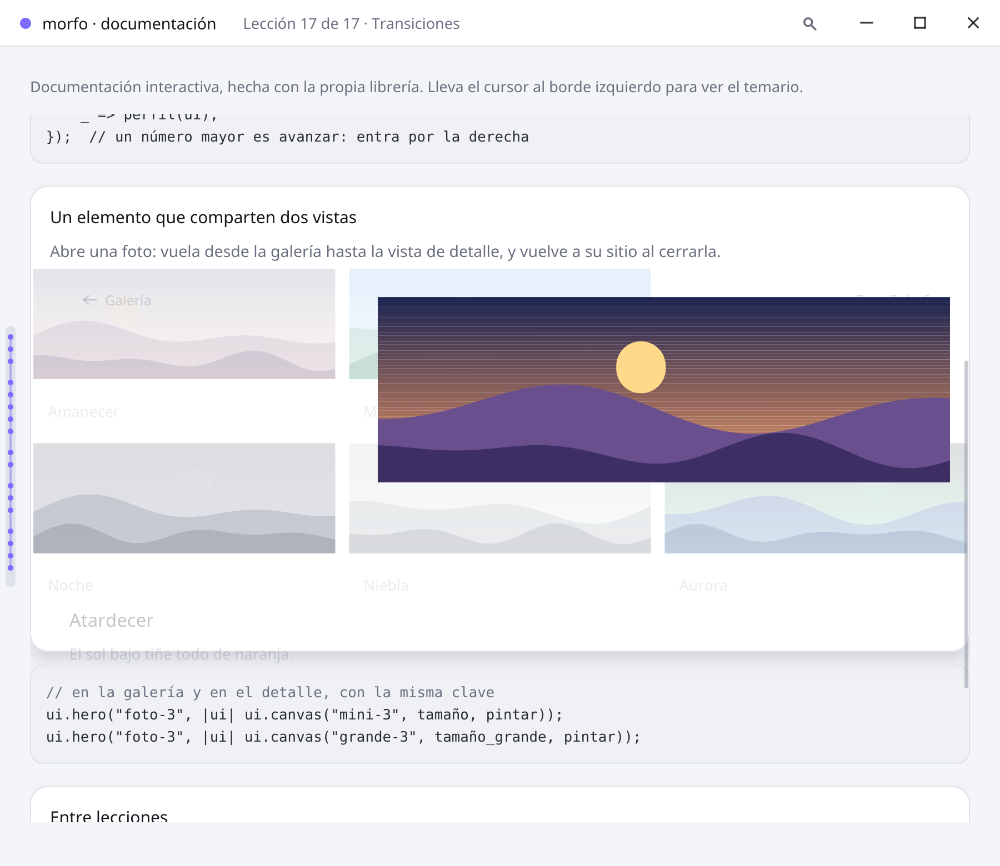

# morfo

Componentes de interfaz en Rust donde **todo se transforma con fluidez** y la
interfaz **se adapta a cada persona según cómo la usa**. Dos usuarios del mismo
programa pueden acabar viendo interfaces distintas.

| Documentación interactiva | Temario del curso desplegado |
| --- | --- |
|  |  |
| **Interfaz ya adaptada al uso** | **Tipos de botón y sus variantes** |
|  |  |
| **Controles, con otro color de acento** | **Paleta de comandos (Ctrl+K)** |
|  |  |
| **Buscador desplegado desde la lupa** | |
|  | |
| **Tabla ordenada por precio** | **Rejilla, columnas y alineación** |
|  |  |
| **Lo siguiente que sueles hacer** | **Tus hábitos, con su porqué** |
|  |  |
| **Dibujo libre: arcos y polígonos** | **La misma interfaz pintada por la GPU** |
|  |  |
| **Diálogo que crece desde su botón** | **Controles de selección** |
|  |  |
| **Un botón mutando en tarjeta** | **Mutado según el uso** |
|  |  |
| **Gráficos que viajan a sus datos** | **Calendario de un selector de fecha** |
|  |  |
| **Panel lateral sobre el contenido** | **Tablero: una tarjeta en la mano** |
|  |  |
| **Paralaje: cada capa a su velocidad** | **Una foto volando hasta su detalle** |
|  |  |
| **Contenido propio en pestañas, menús y tablas** | |
|  | |

## Ideas clave

- **Identidad = morph.** Cada elemento tiene un `Id` estable. El layout solo
  calcula *destinos*; unos muelles llevan hasta ellos la posición, el tamaño,
  el radio, los colores y la tipografía. Reordenar, redimensionar, cambiar de
  variante o de tema es siempre una transición continua, sin escribir código
  de animación.
- **Mutación.** Un componente puede convertirse en otro distinto (un botón en
  un campo de texto, una casilla en una tarjeta): `ui.morph(clave, forma, …)`
  hace viajar la forma de fondo de uno a otro (posición, tamaño, radio y
  color) mientras el contenido se funde, y los vecinos se apartan al mismo
  ritmo. La «forma» puede ser cualquier valor con `Hash`, incluido el peso que
  el uso le ha dado a un elemento.
- **Componentes dentro de componentes.** Un contenedor con clave (`card`,
  `dialog`, `scroll`, `accordion`, `transition`…) es dueño de lo que contiene:
  sus claves quedan bajo la suya, así que un componente hecho de otros se
  repite sin que sus piezas choquen, y `ui.find(clave)` encuentra algo
  anidado sin escribir la ruta. Cualquier contenido puede ser un botón
  (`pressable`), apagarse entero (`enabled`) o heredar tamaño, acento y
  variante (`with_size`, `with_accent`, `with_variant`).
- **Scroll y transiciones.** Lo que hay dentro de un área de scroll se mueve
  con ella como una sola pieza, y puede reaccionar a ella: entrar al verse
  (`scroll_reveal`, escalonado si llegan varios), contar (`count_up`), moverse
  a otra velocidad (`parallax`) o quedarse fijo arriba (`sticky_section`).
  `ui.transition(clave, vista, estilo, …)` cambia de vista con una de siete
  coreografías, en la dirección del avance, y lo que dos vistas comparten
  (`hero`) vuela de un sitio a otro.
- **Muelles analíticos.** La solución cerrada del muelle amortiguado es lineal
  en posición y velocidad, así que sus 4 coeficientes se calculan una vez por
  frame y cada valor animado avanza con 4 multiplicaciones. Exacto a cualquier
  frecuencia de refresco, interrumpible en cualquier momento conservando la
  velocidad.
- **Motor adaptativo.** `Profile` guarda por elemento una puntuación de uso
  que decae con el tiempo. De ahí salen el orden (`arrange`) y el peso visual
  (`prominence`), ambos con histéresis para que nada baile. Nada se mueve
  mientras el puntero está encima. Aprende también *cuándo* se usa cada cosa
  (hora del día) y *qué viene después de qué* (`predict`), y puede explicar
  por qué coloca algo donde lo coloca (`explain`). El perfil se serializa a
  texto para guardarlo por usuario.
- **La persona manda.** Puede ver lo que la interfaz ha aprendido
  (`ui.habits()`, con nombre y motivo), olvidar un hábito (`forget`), pausar
  el aprendizaje (`frozen`), copiar su perfil o borrarlo entero.
- **Coste cero en reposo.** `ui.end()` indica si algo sigue moviéndose; si no,
  el programa no dibuja ni calcula nada hasta el siguiente evento.
- **Solo el trabajo que se ve.** Un frame estable del núcleo no asigna
  memoria. Las medidas de
  texto y el partido en líneas de cada párrafo se recuerdan mientras no
  cambien; las tarjetas lejos de la vista de su área de scroll no se
  construyen; y el renderizador por CPU repinta solo el rectángulo que
  cambió.
- **Independiente del renderizador.** El núcleo no tiene ninguna dependencia
  y produce una lista plana de primitivas. Hay tres backends: CPU
  (`morfo-skia`), GPU (`morfo-wgpu`) y web (`morfo-web`, WebAssembly sobre
  canvas). Un test comprueba que CPU y GPU pintan la misma imagen.
- **Accesible.** Todo se maneja con teclado (Tab, Enter, Espacio, flechas)
  con un anillo de foco que salta de un elemento a otro, y la interfaz se
  describe a los lectores de pantalla (AccessKit en la demo).

## Uso

```rust
use morfo::{Theme, Ui, Vec2};

let mut ui = Ui::new(Theme::dark());
let mut oscuro = true;

// cada frame:
ui.begin(tiempo_en_segundos, Vec2::new(ancho, alto));
ui.heading("Hola");
if ui.button("guardar", "Guardar").clicked { /* ... */ }
ui.toggle("oscuro", &mut oscuro);
// Barra que se reordena y redimensiona según el uso de esta persona:
if let Some(i) = ui.adaptive_actions("acciones", &[("nuevo", "Nuevo"), ("abrir", "Abrir")]) { /* ... */ }
let frame = ui.end();

renderer.render(ui.draw_list(), &mut pixmap, escala, ui.background());
if frame.animating { /* pedir otro frame */ }
```

La entrada se pasa con `pointer_moved`, `pointer_pressed`, `pointer_released`,
`pointer_left`, `scroll_wheel`, `key_pressed`, `text_input`, `paste`,
`ime_preedit` y `set_modifiers`; el texto copiado sale por `take_clipboard`. Si
`frame.animating` es falso, `frame.wake_in` dice en cuántos segundos hará
falta un frame sin que haya entrada (un aviso que caduca, el cursor de texto).
Para guardar y restaurar la forma de cada usuario: `ui.profile().encode()` y
`ui.set_profile(Profile::decode(texto)?)`. Para retomar la interfaz donde se
dejó tras relanzar el programa: `ui.save_state()` y `ui.restore_state(texto)`
(la posición de cada scroll), y `ui.set_instant(true)` durante unos frames sin
pintar para que el primero que se vea esté ya quieto y en su sitio.

### Componentes

| Grupo | Componentes |
| --- | --- |
| Texto | `label`, `muted`, `title`, `heading`, `text` (tamaño libre), `code`, `paragraph` y `paragraph_muted` (se ajustan al ancho) |
| Botones | `button`, `button_with`, `icon_button` (solo icono), `button_icon` (icono y texto), `toggle_button` (se queda pulsado), `loading_button` (se encoge en un indicador mientras carga), `hold_button` (mantener para confirmar). Todos con las variantes `Solid`, `Soft`, `Outline`, `Ghost` y los tamaños `Sm`, `Md`, `Lg` |
| Iconos | `Icon`: 18 iconos vectoriales (flechas, cerrar, buscar, inicio, descargar, reproducir, maximizar…) |
| Controles | `toggle`, `slider`, `progress`, `segmented`, `range_slider` (rango con dos manijas), `knob` (perilla), `xy_pad` (pad de dos ejes), `rating` (estrellas), `swatches` (muestras de color) |
| Selección | `checkbox`, `radio`, `chip`, `stepper`, `accordion` |
| Cajas | `row`, `row_top`, `fill` (empuja el resto de la fila al final), `column`, `grid`, `columns` (anchos con peso), `align`, `card`, `separator`, `reveal`, `scroll` (rebota al pasar de un extremo), `scope`, `surface`, `canvas` (dibujo libre), `presence`, `transient` (cualquier contenido anima su salida), `splitter` (dos paneles con un divisor que se arrastra), `virtual_list` (lista de filas iguales que solo construye las que se ven: cuesta lo mismo con cien filas que con cien mil) |
| Flotantes | `dialog`, `menu`, `tooltip`, `toast`, `notice` (aviso fijo en una esquina mientras se declare: trabajo en curso, sin conexión, un error), `close` |
| Navegación | `course_nav` (temario de curso en el borde izquierdo: módulos, lecciones numeradas en una línea de tiempo y progreso que se recuerda), `side_nav` (índice simple), `search` (lupa que se despliega en un buscador con resultados), `tabs` (subrayado que salta entre pestañas), `breadcrumbs` (el centro se pliega en «…» si no cabe), `tree` (ramas que se despliegan; recuerda cuáles están abiertas), `pagination`, `drawer` (panel que entra por un lado de la ventana) |
| Ventana | `title_bar` (barra propia de la aplicación en lugar de la del gestor de ventanas: título, contenido propio, minimizar, maximizar/restaurar, cerrar, arrastrar, doble clic y bordes para redimensionar) |
| Entrada | `text_field` y `text_area` (selección con ratón y Mayús, Ctrl+A/C/X/V, métodos de entrada; el área es multilínea con ajuste y scroll), `select` (desplegable), `combobox` (sugerencias sin distinguir tildes), `date_picker` (calendario del mes, con el tipo `Date`), `color_picker` (cuadrado de saturación y brillo, barra de tono), `tag_input` (lo escrito se convierte en etiquetas), `multi_select` (varias opciones con buscador), `shortcut_input` (graba una combinación de teclas como `Shortcut`; el programa le pasa Ctrl+tecla con `chord` mientras `wants_keys`) |
| Datos | `table` (ordenable por columnas; las filas viajan al ordenar), `reorderable` (lista que se reordena arrastrando), `kanban` (tablero de columnas; las tarjetas se arrastran entre ellas) |
| Gráficos | `bar_chart`, `line_chart` (varias series), `sparkline` (tendencia en una línea), `heatmap`, `gauge`: valores y escala son muelles, y al pasar el ratón se ve cada valor |
| Estado | `skeleton` (líneas grises con brillo que se transforman en el contenido al cargar), `badge` y `badge_on` (contador que salta al cambiar y se va en cero), `steps` (procesos por pasos) |
| Adaptativos | `adaptive_actions`, `adaptive_menu`, `suggestions`, `predicted_action` (ofrece el siguiente paso habitual), `adaptive_dashboard` (inicio que se reordena y agranda lo más usado), `command_palette`, `set_adaptive_density` (más compacta cuanto más se usa), `habits`, `why` |
| Accesibilidad | `set_accessibility`, `access_nodes`, `access_click`, `access_focus` |
| Dibujo | `DrawList::polygon`, `DrawList::arc`, rectángulos, líneas y texto (dentro de `canvas`) |
| Mutación | `morph` (cualquier componente o grupo se transforma en otro), `request_focus` |
| Scroll | `scroll_reveal` (entra al verse con `Reveal::Fade`, `Rise`, `Left`, `Right`, `Grow` o `Wipe`; los que llegan juntos, uno tras otro), `count_up` (número que cuenta desde cero al verse), `parallax` (capas a distintas velocidades), `sticky_section` (cabecera fija hasta que la siguiente la empuja; se anidan), `anchor` y `scroll_to` (viaje con muelle hasta una sección), `scroll_progress` y `scroll_linked` (valores ligados a la posición) |
| Composición | `pressable` (cualquier contenido como un botón; los controles de dentro siguen siendo suyos), `enabled` (apaga todo lo que contiene: atenuado, sin puntero ni teclado, anunciado como desactivado), `tabs_with`, `menu_with`, `table_with` y `accordion_with` (cada pestaña, opción, celda o cabecera muestra lo que construyas), `with_size`, `with_accent` y `with_variant` (estilo que hereda lo de dentro), `find` y `find_all` (el elemento declarado con una clave, esté donde esté) |
| Transiciones | `transition` (cambio de vista con `Transition::Fade`, `Slide`, `Shift`, `Push`, `Zoom`, `Flip` o `Rise`, en la dirección del avance), `hero` (elemento compartido que vuela de una vista a otra) |

Los flotantes se dibujan en capas superiores, bloquean lo que tapan y animan
también su salida. Para adaptar componentes propios: `ui.affinity(key)`,
`ui.prominence(key)`, `ui.record(key)` y `Profile::arrange`.

## Documentación con ejemplos

```bash
cargo run --release -p morfo-demo --bin docs
```

Dibuja con la GPU si la hay (si no, con la CPU; `-- --cpu` la fuerza).

### Cambios en vivo mientras desarrollas

Lanzada con `cargo run` (el comando de arriba), la documentación se recarga
sola. Al guardar un fuente (de la demo, del núcleo o de un renderizador)
recompila en segundo plano y se relanza en el sitio: la misma página, el
mismo scroll y tema, lo escrito en los campos, y la ventana donde estaba, sin
quitarle el teclado al editor. Mientras compila lo avisa en una esquina; si no compila, sigue en
marcha la versión anterior y el aviso muestra el primer error.

Una recarga tarda lo que tarde la compilación incremental, y en release (por
el LTO) eso es más de un minuto. Por eso la documentación recarga siempre con
el perfil `dev`, aunque se arranque con `--release`: entre 1 y 5 s por
cambio. La primera recarga compila ese perfil entero si aún no existe (unos
minutos, una sola vez). `MORFO_LIVE_PROFILE=release` mantiene las recargas
optimizadas y `MORFO_LIVE=0` las desactiva. Un binario lanzado sin
`cargo run` no vigila nada.

Para una app propia es el crate `morfo-live` (sin dependencias, Unix):

```rust
use morfo_live::{Live, Snapshot, Status};

struct Estado { pagina: usize, nombre: String }
morfo_live::persist!(Estado { pagina, nombre });   // genera save() y restore()

// Al arrancar: lo que dejó la compilación anterior, si esto es una recarga.
if let Some(snap) = morfo_live::restored() {
    estado.restore(&snap);
    ui.restore_state(&snap.get::<String>("ui").unwrap_or_default());
}
// `despertar` se llama desde otro hilo cuando cambia el estado de la recarga.
// Recompila con el perfil con que se arrancó; `start_with_profile("dev", …)`
// hace que las recargas sean rápidas aunque se arranque con `--release`.
let live = Live::start(despertar);

// En el bucle de eventos:
match live.status() {
    Status::Building => ui.notice("live", "Recompilando…"),
    Status::Failed(error) => ui.notice("live", &error),
    Status::Ready => {
        let mut snap = Snapshot::new();
        estado.save(&mut snap);
        snap.set("ui", &ui.save_state());
        live.restart(&snap);   // el proceso pasa a ser la nueva compilación
    }
    Status::Watching => {}
}
```

Los valores se guardan por nombre: un campo que la nueva compilación ya no
tiene se ignora y uno nuevo conserva su valor por defecto, así que el estado
sobrevive a los mismos cambios de código que provocan la recarga. El ejemplo
completo, con la posición de la ventana, está en `demo/src/bin/docs.rs`.

La misma documentación funciona en el navegador:

```bash
./web/build.sh && python3 -m http.server -d web 8000
```

Necesita `rustup target add wasm32-unknown-unknown` y `wasm-bindgen-cli` en la
versión de `Cargo.lock`.

La documentación es una app hecha con morfo. Tiene dieciocho páginas (Inicio,
Botones, Controles, Selección, Cajas, Composición, Formas, Entrada,
Formularios, Flotantes, Estado y paneles, Navegación, Datos, Gráficos,
Adaptativo, Mutación, Scroll y Transiciones), ordenadas como un curso de cinco módulos;
al cambiar de lección, la nueva llega desde el lado hacia el que se avanza. El temario vive
en el borde izquierdo: se despliega al acercar el cursor, marca las lecciones
vistas y recuerda el progreso. Arriba a la derecha, una lupa se despliega en
un buscador de lecciones y acciones (Ctrl+K en escritorio), y al final de
cada lección hay botones para pasar a la anterior o a la siguiente. Cada página explica un
grupo de componentes, lo muestra funcionando y enseña el código que lo
produce. Su fuente, `demo/src/lib.rs`, sirve también de ejemplo completo.
El perfil de uso se guarda al cerrar en `~/.config/morfo-demo/profile.txt`.

```bash
cargo run --release -p morfo-demo --bin snapshot
```

Recorre la documentación simulando a un usuario, sin ventana; guarda frames
PNG en `out/` y mide el trabajo real.

```bash
cargo test --workspace
```

Incluye la comparación píxel a píxel entre GPU y CPU (se salta si no hay GPU).

## Medidas

Con la documentación (`--release`, ventana de 900×780 a 2× = 1800×1560 px,
portátil de 4 núcleos con otros programas abiertos). Las produce
`cargo run --release -p morfo-demo --bin snapshot`:

| Situación | Pintado por frame | Filas que abarca |
| --- | --- | --- |
| En reposo | nada | 0 % |
| Mover el ratón sobre botones | 0,3–0,6 ms | 6 % |
| Escribir en un campo de texto | 0,2–0,4 ms | 4–7 % |
| Cambiar de página (todo se mueve) | ~9 ms | 86 % |
| Abrir un diálogo (oscurece la pantalla) | ~11 ms | 72 % |

Construir la interfaz y avanzar todas las animaciones cuesta unos 50 µs por
frame de media en la documentación (entre 30 y 100 µs según la página), y
un frame estable del núcleo no asigna memoria. Lo que está lejos de la vista
no cuenta: una página de scroll con 2000 tarjetas de diez botones se
construye en 0,17 ms, y una lista virtual cuesta lo mismo con cien filas que
con veinte mil.

El renderizador repinta solo el rectángulo que cambia respecto al frame
anterior, lo reparte en franjas entre hilos y dibuja rectángulos y sombras
con un rasterizador propio que solo calcula el contorno. El simulador
comprueba que el resultado incremental es idéntico, píxel a píxel, a un
repintado completo.

## Estructura

| Ruta | Qué es |
| --- | --- |
| `crates/morfo` | Núcleo sin dependencias (`morfo-ui` en crates.io, se importa como `morfo`): muelles, perfil adaptativo, layout, componentes, accesibilidad, lista de dibujo |
| `crates/morfo-skia` | Renderizador por CPU con repintado parcial y en paralelo |
| `crates/morfo-wgpu` | Renderizador por GPU (wgpu): un shader, una llamada por región de recorte |
| `crates/morfo-web` | Backend web: canvas, eventos del navegador, portapapeles, IME |
| `crates/morfo-live` | Recarga en vivo durante el desarrollo: vigila los fuentes, recompila y relanza el programa conservando su estado |
| `demo` | Documentación en ventana (GPU o CPU, AccessKit, portapapeles) y simulador sin ventana |
| `web` | La documentación compilada a WebAssembly |

## Limitaciones actuales

- La recarga en vivo relanza el programa entero (solo en Unix): lo que no se
  guarde en el `Snapshot` empieza de nuevo, la ventana parpadea un instante y
  en Wayland vuelve donde el compositor decida.
- Una fuente normal y una monoespaciada; sin negritas, cursivas ni texto
  bidireccional (árabe, hebreo).
- La tabla dibuja todas sus filas; para miles de filas, `virtual_list` o
  paginarla.
- El scroll es vertical y con rueda (sin arrastrar la barra). Dentro de un
  área de scroll, las tarjetas lejos de la vista no se construyen: conservan
  el tamaño que tenían la última vez que se vieron, así que si su contenido
  cambia de tamaño mientras tanto, solo ocupa el nuevo al acercarse, y
  `find` no encuentra lo que contienen. El resto del contenido fuera de la
  vista no se dibuja, pero sí pasa por el layout. `set_lazy(false)` lo
  desactiva.
- `virtual_list` coloca las filas con exactitud hasta unas decenas de miles;
  mucho más allá pueden quedar a una fracción de píxel de su sitio.
- Durante una mutación, una transición o una entrada con `scroll_reveal`, los
  controles nuevos ya responden en su posición final, aunque aún se estén
  dibujando a medio camino. La vista que se va en una transición es solo una
  imagen: no responde, y lo que tenía en capas flotantes desaparece al momento.
- `title_bar` no mueve ni cierra la ventana por sí misma: devuelve lo que
  pidió el usuario y el programa lo hace. Arrastrar y redimensionar dependen
  del gestor de ventanas.
- La accesibilidad describe cada elemento por separado, sin jerarquía (las
  tarjetas no agrupan a sus hijos para el lector de pantalla).
- En la web el texto lo dibuja el navegador con fuentes del sistema, así que
  puede variar algún píxel respecto al escritorio, y el recorte es
  rectangular.
- El backend por CPU recorta por rectángulos: ignora el radio de las
  esquinas de un recorte.
- Los hábitos por hora del día necesitan que el programa indique la zona
  horaria (`Profile::time_of_day`); la demo y la web lo hacen.

## Licencia

MIT o Apache-2.0, a tu elección.
