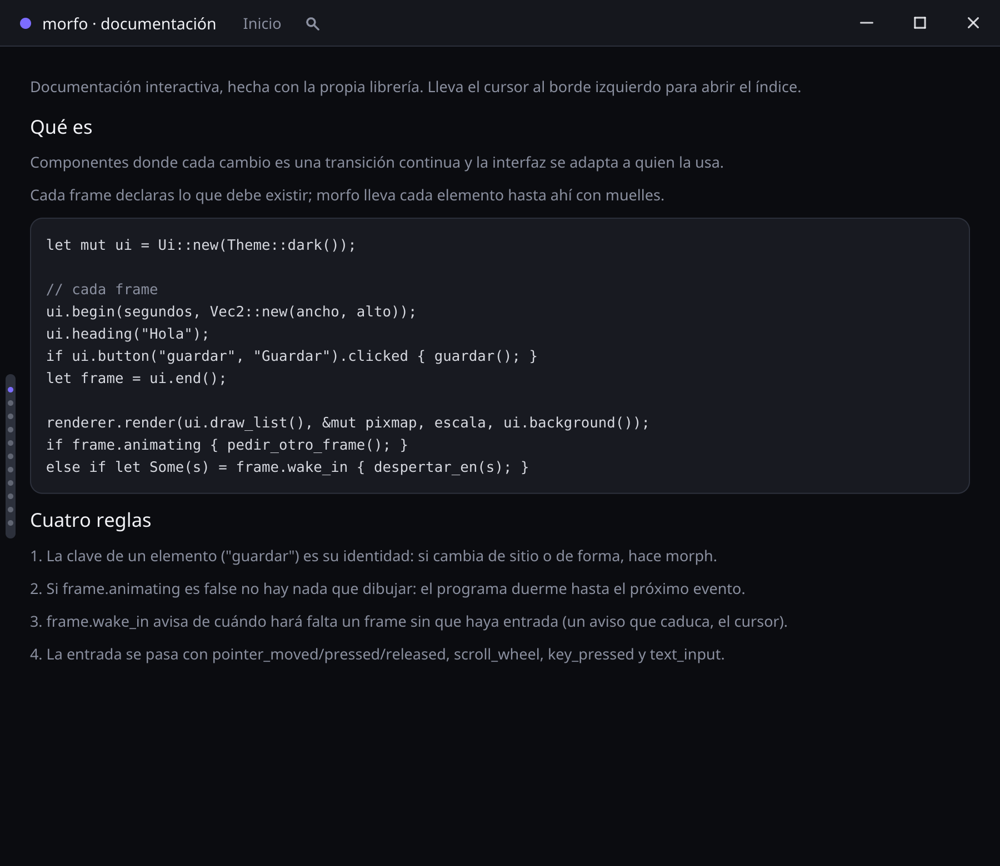
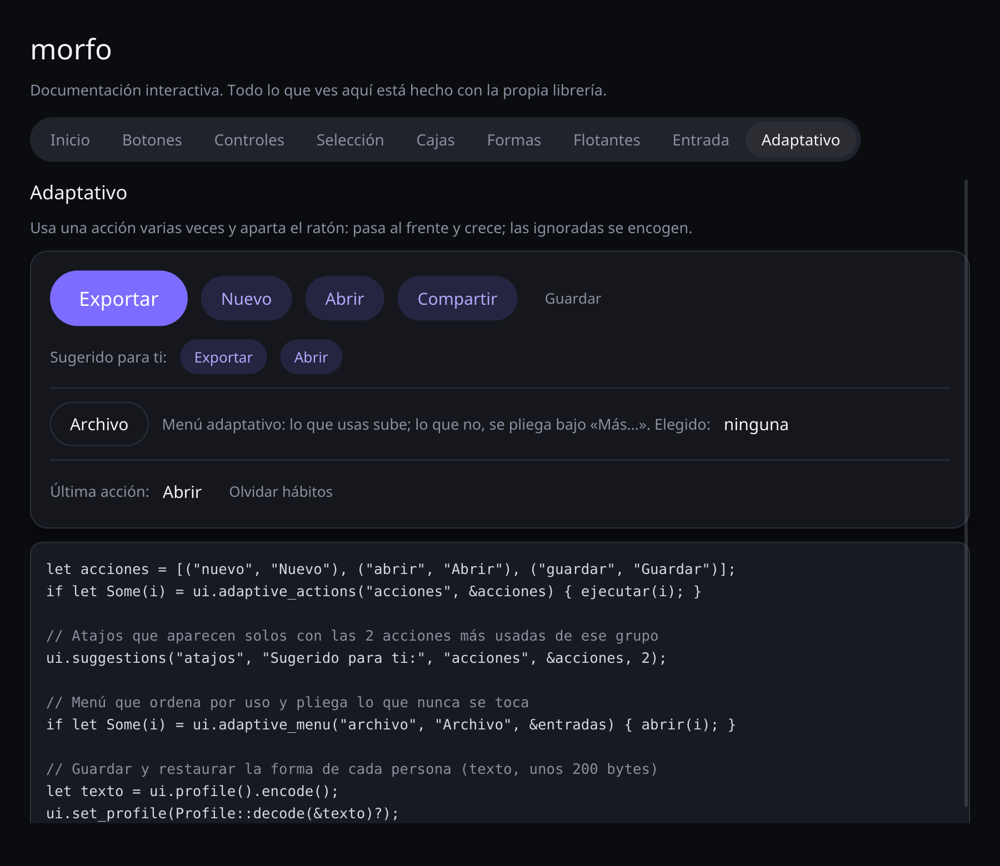
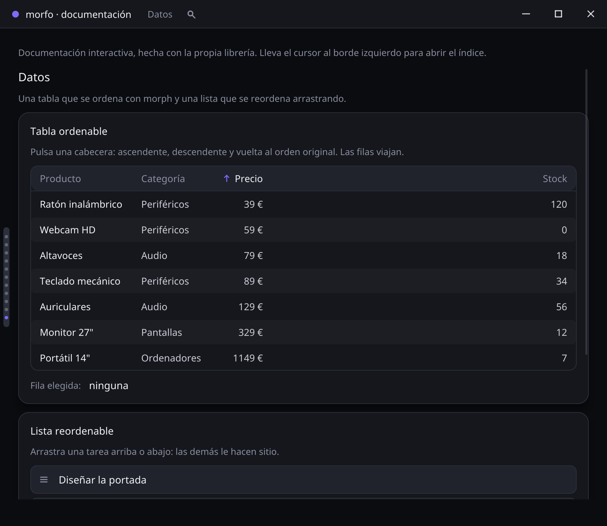
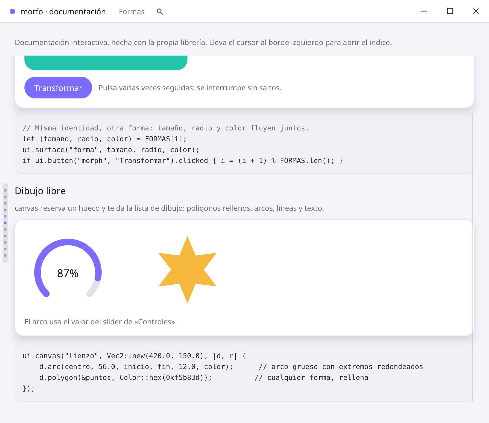
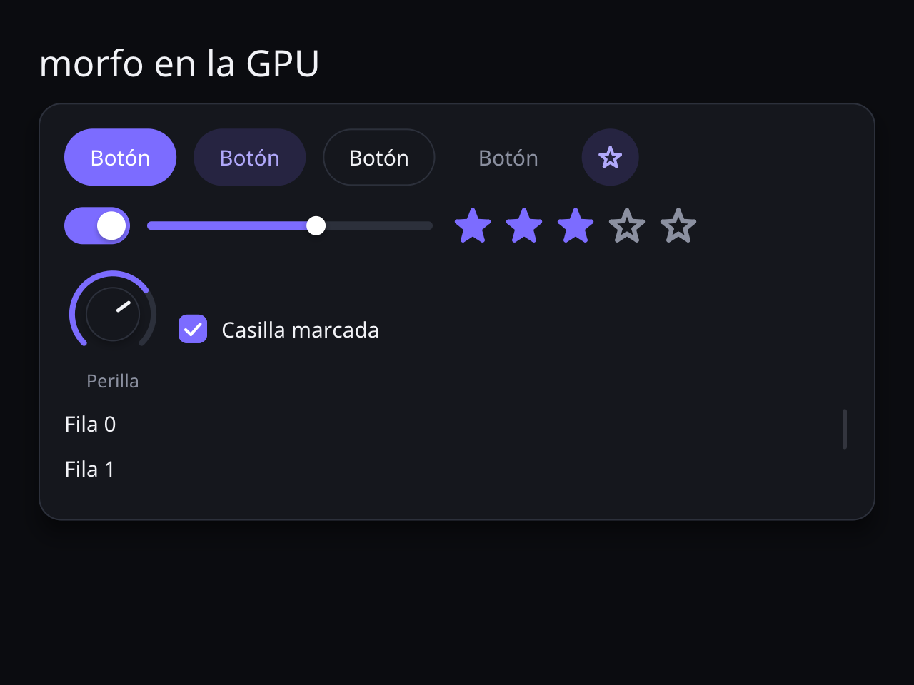
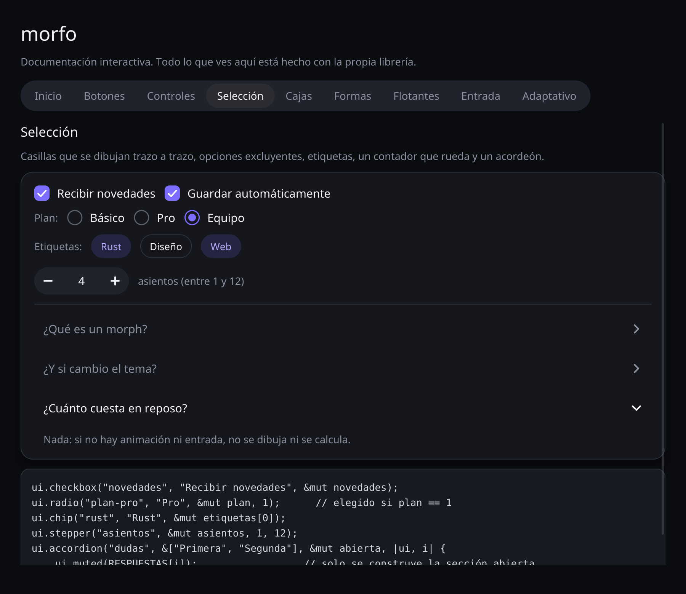
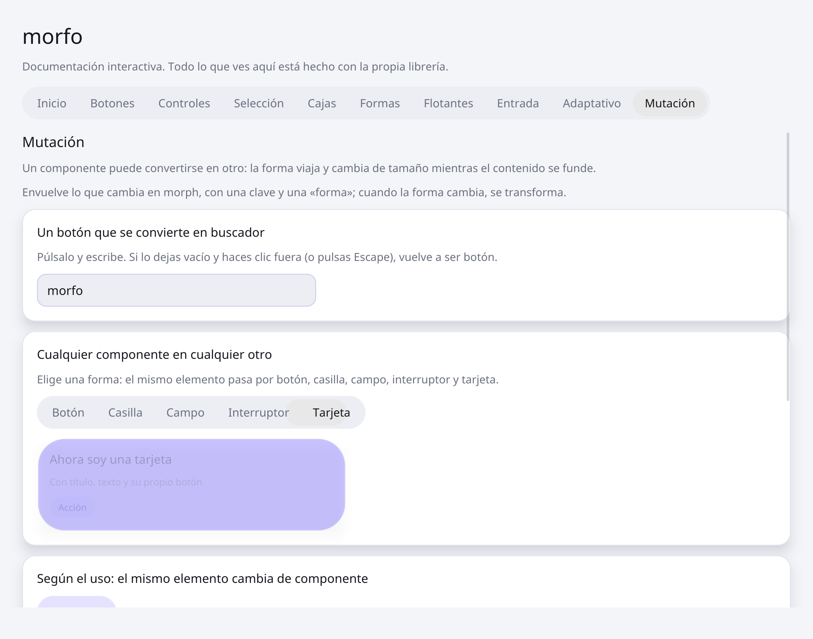

# morfo

Componentes de interfaz en Rust donde **todo se transforma con fluidez** y la
interfaz **se adapta a cada persona según cómo la usa**. Dos usuarios del mismo
programa pueden acabar viendo interfaces distintas.

| Documentación interactiva | Índice lateral desplegado |
| --- | --- |
|  |  |
| **Interfaz ya adaptada al uso** | **Tipos de botón y sus variantes** |
|  |  |
| **Controles, con otro color de acento** | **Paleta de comandos (Ctrl+K)** |
|  |  |
| **Tabla ordenada por precio** | **Rejilla, columnas y alineación** |
|  |  |
| **Lo siguiente que sueles hacer** | **Tus hábitos, con su porqué** |
|  |  |
| **Dibujo libre: arcos y polígonos** | **La misma interfaz pintada por la GPU** |
|  |  |
| **Diálogo que crece desde su botón** | **Controles de selección** |
|  |  |
| **Un botón mutando en tarjeta** | **Mutado según el uso** |
|  |  |

## Ideas clave

- **Identidad = morph.** Cada elemento tiene un `Id` estable. El layout solo
  calcula *destinos*; unos muelles llevan hasta ellos la posición, el tamaño,
  el radio, los colores y la tipografía. Reordenar, redimensionar, cambiar de
  variante o de tema es siempre una transición continua, sin escribir código
  de animación.
- **Mutación.** Un componente puede convertirse en otro distinto (un botón en
  un campo de texto, una casilla en una tarjeta): `ui.morph(clave, forma, …)`
  hace viajar la forma de fondo de uno a otro (posición, tamaño, radio y
  color) mientras el contenido se funde, y los vecinos se apartan al mismo
  ritmo. La «forma» puede ser cualquier valor con `Hash`, incluido el peso que
  el uso le ha dado a un elemento.
- **Muelles analíticos.** La solución cerrada del muelle amortiguado es lineal
  en posición y velocidad, así que sus 4 coeficientes se calculan una vez por
  frame y cada valor animado avanza con 4 multiplicaciones. Exacto a cualquier
  frecuencia de refresco, interrumpible en cualquier momento conservando la
  velocidad.
- **Motor adaptativo.** `Profile` guarda por elemento una puntuación de uso
  que decae con el tiempo. De ahí salen el orden (`arrange`) y el peso visual
  (`prominence`), ambos con histéresis para que nada baile. Nada se mueve
  mientras el puntero está encima. Aprende también *cuándo* se usa cada cosa
  (hora del día) y *qué viene después de qué* (`predict`), y puede explicar
  por qué coloca algo donde lo coloca (`explain`). El perfil se serializa a
  texto para guardarlo por usuario.
- **La persona manda.** Puede ver lo que la interfaz ha aprendido
  (`ui.habits()`, con nombre y motivo), olvidar un hábito (`forget`), pausar
  el aprendizaje (`frozen`), copiar su perfil o borrarlo entero.
- **Coste cero en reposo.** `ui.end()` indica si algo sigue moviéndose; si no,
  el programa no dibuja ni calcula nada hasta el siguiente evento.
- **Independiente del renderizador.** El núcleo no tiene ninguna dependencia
  y produce una lista plana de primitivas. Hay tres backends: CPU
  (`morfo-skia`), GPU (`morfo-wgpu`) y web (`morfo-web`, WebAssembly sobre
  canvas). Un test comprueba que CPU y GPU pintan la misma imagen.
- **Accesible.** Todo se maneja con teclado (Tab, Enter, Espacio, flechas)
  con un anillo de foco que salta de un elemento a otro, y la interfaz se
  describe a los lectores de pantalla (AccessKit en la demo).

## Uso

```rust
use morfo::{Theme, Ui, Vec2};

let mut ui = Ui::new(Theme::dark());
let mut oscuro = true;

// cada frame:
ui.begin(tiempo_en_segundos, Vec2::new(ancho, alto));
ui.heading("Hola");
if ui.button("guardar", "Guardar").clicked { /* ... */ }
ui.toggle("oscuro", &mut oscuro);
// Barra que se reordena y redimensiona según el uso de esta persona:
if let Some(i) = ui.adaptive_actions("acciones", &[("nuevo", "Nuevo"), ("abrir", "Abrir")]) { /* ... */ }
let frame = ui.end();

renderer.render(ui.draw_list(), &mut pixmap, escala, ui.background());
if frame.animating { /* pedir otro frame */ }
```

La entrada se pasa con `pointer_moved`, `pointer_pressed`, `pointer_released`,
`pointer_left`, `scroll_wheel`, `key_pressed`, `text_input`, `paste`,
`ime_preedit` y `set_modifiers`; el texto copiado sale por `take_clipboard`. Si
`frame.animating` es falso, `frame.wake_in` dice en cuántos segundos hará
falta un frame sin que haya entrada (un aviso que caduca, el cursor de texto).
Para guardar y restaurar la forma de cada usuario: `ui.profile().encode()` y
`ui.set_profile(Profile::decode(texto)?)`.

### Componentes

| Grupo | Componentes |
| --- | --- |
| Texto | `label`, `muted`, `title`, `heading`, `text` (tamaño libre), `code`, `paragraph` y `paragraph_muted` (se ajustan al ancho) |
| Botones | `button`, `button_with`, `icon_button` (solo icono), `button_icon` (icono y texto), `toggle_button` (se queda pulsado), `loading_button` (se encoge en un indicador mientras carga), `hold_button` (mantener para confirmar). Todos con las variantes `Solid`, `Soft`, `Outline`, `Ghost` y los tamaños `Sm`, `Md`, `Lg` |
| Iconos | `Icon`: 18 iconos vectoriales (flechas, cerrar, buscar, inicio, descargar, reproducir, maximizar…) |
| Controles | `toggle`, `slider`, `progress`, `segmented`, `range_slider` (rango con dos manijas), `knob` (perilla), `xy_pad` (pad de dos ejes), `rating` (estrellas), `swatches` (muestras de color) |
| Selección | `checkbox`, `radio`, `chip`, `stepper`, `accordion` |
| Cajas | `row`, `row_top`, `column`, `grid`, `columns` (anchos con peso), `align`, `card`, `separator`, `reveal`, `scroll`, `scope`, `surface`, `canvas` (dibujo libre), `presence`, `transient` (cualquier contenido anima su salida) |
| Flotantes | `dialog`, `menu`, `tooltip`, `toast`, `close` |
| Navegación | `side_nav` (índice oculto en el borde izquierdo que se despliega al acercar el cursor) |
| Ventana | `title_bar` (barra propia de la aplicación en lugar de la del gestor de ventanas: título, contenido propio, minimizar, maximizar/restaurar, cerrar, arrastrar, doble clic y bordes para redimensionar) |
| Entrada | `text_field` y `text_area` (selección con ratón y Mayús, Ctrl+A/C/X/V, métodos de entrada; el área es multilínea con ajuste y scroll), `select` (desplegable), `combobox` (sugerencias sin distinguir tildes) |
| Datos | `table` (ordenable por columnas; las filas viajan al ordenar), `reorderable` (lista que se reordena arrastrando) |
| Adaptativos | `adaptive_actions`, `adaptive_menu`, `suggestions`, `predicted_action` (ofrece el siguiente paso habitual), `adaptive_dashboard` (inicio que se reordena y agranda lo más usado), `command_palette`, `set_adaptive_density` (más compacta cuanto más se usa), `habits`, `why` |
| Accesibilidad | `set_accessibility`, `access_nodes`, `access_click`, `access_focus` |
| Dibujo | `DrawList::polygon`, `DrawList::arc`, rectángulos, líneas y texto (dentro de `canvas`) |
| Mutación | `morph` (cualquier componente o grupo se transforma en otro), `request_focus` |

Los flotantes se dibujan en capas superiores, bloquean lo que tapan y animan
también su salida. Para adaptar componentes propios: `ui.affinity(key)`,
`ui.prominence(key)`, `ui.record(key)` y `Profile::arrange`.

## Documentación con ejemplos

```bash
cargo run --release -p morfo-demo --bin docs
```

Dibuja con la GPU si la hay (si no, con la CPU; `-- --cpu` la fuerza).

La misma documentación funciona en el navegador:

```bash
./web/build.sh && python3 -m http.server -d web 8000
```

Necesita `rustup target add wasm32-unknown-unknown` y `wasm-bindgen-cli` en la
versión de `Cargo.lock`.

La documentación es una app hecha con morfo. Tiene once páginas (Inicio,
Botones, Controles, Selección, Cajas, Formas, Flotantes, Entrada, Adaptativo,
Mutación, Datos), con su propia barra de ventana en lugar de la del sistema, y a
las que se llega con un índice lateral: un riel en el borde
izquierdo que se despliega al acercar el cursor. Cada página explica un
grupo de componentes, lo muestra funcionando y enseña el código que lo
produce. Su fuente, `demo/src/lib.rs`, sirve también de ejemplo completo.
El perfil de uso se guarda al cerrar en `~/.config/morfo-demo/profile.txt`.

```bash
cargo run --release -p morfo-demo --bin snapshot
```

Recorre la documentación simulando a un usuario, sin ventana; guarda frames
PNG en `out/` y mide el trabajo real.

```bash
cargo test --workspace
```

Incluye la comparación píxel a píxel entre GPU y CPU (se salta si no hay GPU).

## Medidas

Con la documentación (`--release`, ventana de 900×780 a 2× = 1800×1560 px,
portátil de 4 núcleos con otros programas abiertos). Las produce
`cargo run --release -p morfo-demo --bin snapshot`:

| Situación | Pintado por frame | Filas repintadas |
| --- | --- | --- |
| En reposo | nada | 0 % |
| Mover el ratón sobre botones | ~1 ms | 6 % |
| Escribir en un campo de texto | ~1 ms | 4–7 % |
| Cambiar de página (todo se mueve) | ~11 ms | 86 % |
| Abrir un diálogo (oscurece la pantalla) | ~12 ms | 72 % |

Construir la interfaz y avanzar todas las animaciones cuesta entre 40 y
200 µs por frame según la carga de la máquina.

El renderizador repinta solo las filas que cambian respecto al frame
anterior, las reparte en franjas entre hilos y dibuja rectángulos y sombras
con un rasterizador propio que solo calcula el contorno. El simulador
comprueba que el resultado incremental es idéntico, píxel a píxel, a un
repintado completo.

## Estructura

| Ruta | Qué es |
| --- | --- |
| `crates/morfo` | Núcleo sin dependencias (`morfo-ui` en crates.io, se importa como `morfo`): muelles, perfil adaptativo, layout, componentes, accesibilidad, lista de dibujo |
| `crates/morfo-skia` | Renderizador por CPU con repintado parcial y en paralelo |
| `crates/morfo-wgpu` | Renderizador por GPU (wgpu): un shader, una llamada por región de recorte |
| `crates/morfo-web` | Backend web: canvas, eventos del navegador, portapapeles, IME |
| `demo` | Documentación en ventana (GPU o CPU, AccessKit, portapapeles) y simulador sin ventana |
| `web` | La documentación compilada a WebAssembly |

## Limitaciones actuales

- Una fuente normal y una monoespaciada; sin negritas, cursivas ni texto
  bidireccional (árabe, hebreo).
- La tabla dibuja todas sus filas; para miles de filas hace falta paginarla.
- El scroll es vertical y con rueda (sin arrastrar la barra); dibuja solo lo
  visible, pero recorre el layout de todo el contenido.
- Durante una mutación, los controles de la forma nueva ya responden en su
  posición final, aunque aún se estén dibujando a medio camino.
- `title_bar` no mueve ni cierra la ventana por sí misma: devuelve lo que
  pidió el usuario y el programa lo hace. Arrastrar y redimensionar dependen
  del gestor de ventanas.
- La accesibilidad describe cada elemento por separado, sin jerarquía (las
  tarjetas no agrupan a sus hijos para el lector de pantalla).
- En la web el texto lo dibuja el navegador con fuentes del sistema, así que
  puede variar algún píxel respecto al escritorio, y el recorte es
  rectangular.
- El backend por CPU recorta las formas por bandas de filas, no por
  rectángulos arbitrarios (el texto sí se recorta exacto).
- Los hábitos por hora del día necesitan que el programa indique la zona
  horaria (`Profile::time_of_day`); la demo y la web lo hacen.

## Licencia

MIT o Apache-2.0, a tu elección.
